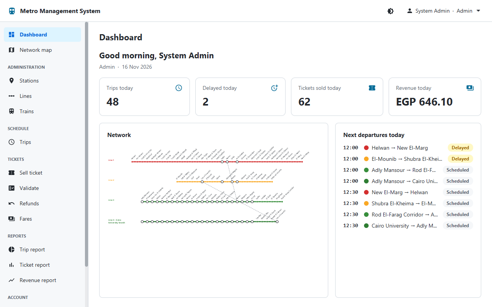
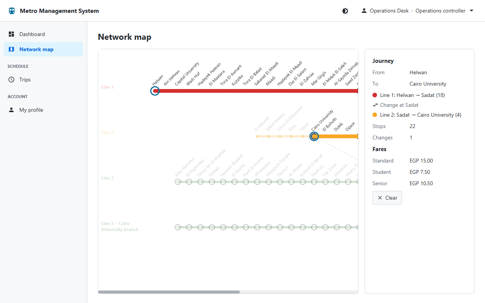
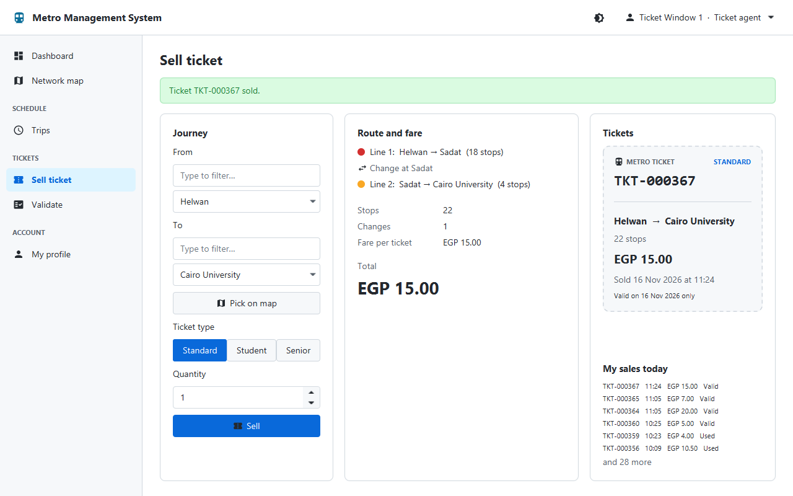
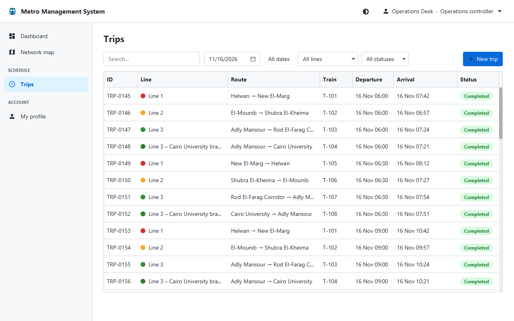
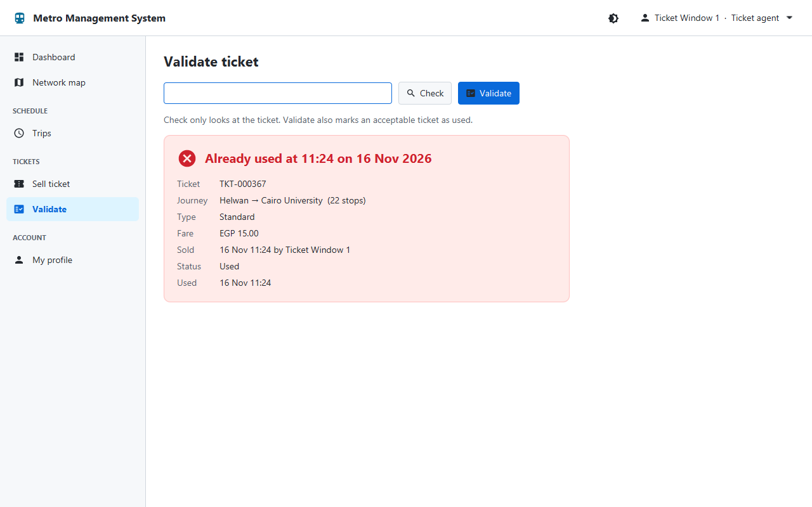
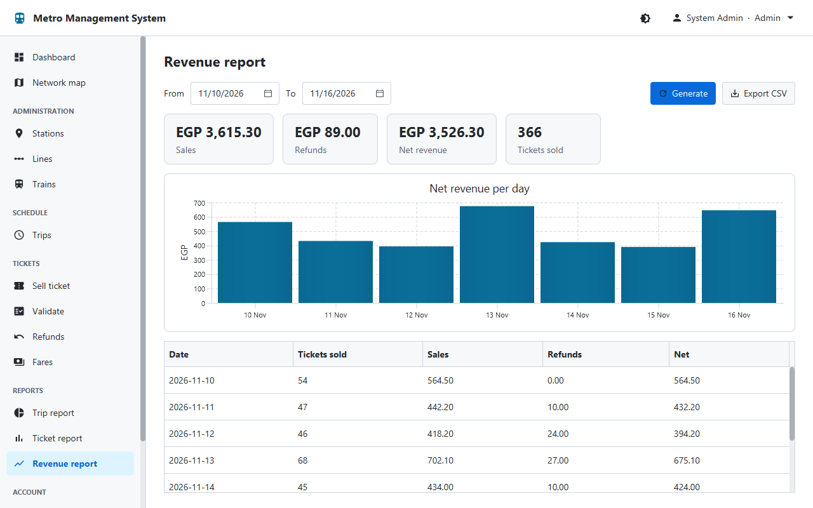
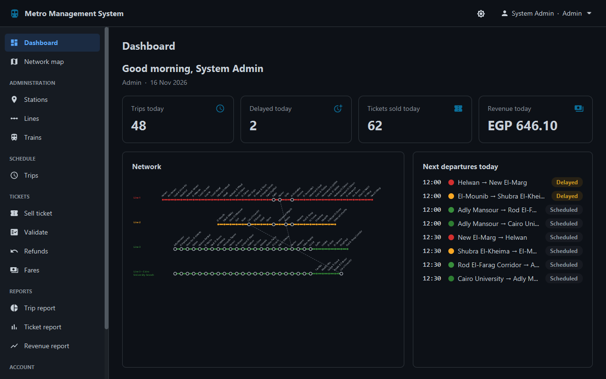
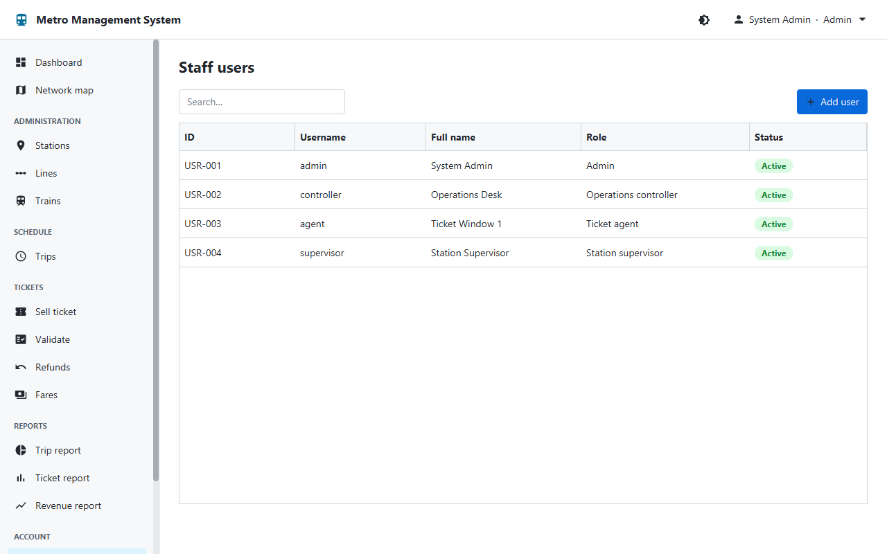
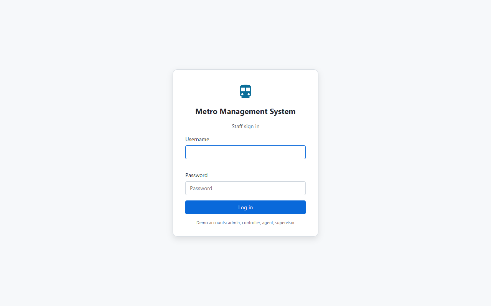

# Metro Management System

[](https://github.com/moazmo/metro-management-system/actions/workflows/build.yml)

A desktop application for running a metro network: stations, lines and
trains; a timetable that refuses to put one train in two places at once;
ticket sales with fares worked out from the shortest route; ticket
validation and refunds; reports with charts; and staff accounts whose role
decides what they can see and do. Written in Java with JavaFX, keeping all
its data in plain text files. Ships with the Cairo Metro as demo data.

Team project for the Programming Language 2 (Java) course — Project 8.



## Features

**Administration**
- Stations: add, edit, delete, list, search; English and Arabic names; interchanges found automatically.
- Lines: name, colour and station order, edited with add, remove, move up and move down.
- Trains: editable train ID, capacity and service status (active, in maintenance, retired).
- Safe deletes: a station on a line, a train with trip history or a line with trips cannot be deleted — the app says why and what to do instead.

**Schedule**
- Trips with departure and arrival; the arrival is suggested from the length of the line.
- Status tracking: scheduled, delayed, completed, cancelled, with only sensible changes allowed.
- Conflict detection: a train cannot be on two trips at once (with a turnaround gap); delays warn about knock-on clashes.

**Tickets**
- Route planner across lines (fewest stops, changes at interchanges) and fares from an editable fare table.
- Standard, student and senior tickets, each with its own discount.
- Validation at the gate: a ticket is used once, only on its day of sale.
- Same-day refunds of unused tickets by supervisors.

**Reports**
- Trips by date, line and status, with a pie chart.
- Tickets sold per journey, busiest first, with a bar chart.
- Revenue per day: sales, refunds and net, with totals.
- Every report exports to CSV.

**Users**
- Four roles — admin, operations controller, ticket agent, station supervisor — each with its own permissions.
- Authorization is enforced twice: the menu hides what a role may not use, and every service refuses it anyway.
- Profile editing (everything except the ID), salted password hashes, an audit log of every important action.

**And also** — an interactive network map that highlights a route, a live dashboard, light and dark mode.

## Screenshots

| | |
|---|---|
|  |  |
| Network map with a route highlighted | Selling a ticket: route, fare and ticket card |
|  |  |
| Timetable with status badges | Validating a ticket that was already used |
|  |  |
| Revenue report | Dark mode |
|  |  |
| Staff users | Login |

## Run it

You need **JDK 25**. Nothing else has to be installed: the build tool is
downloaded by the wrapper script the first time you use it.

```bash
./mvnw javafx:run     # start the application
./mvnw test           # run the tests
```

On Windows PowerShell type `.\mvnw.cmd` in place of `./mvnw`.

The first start creates a `data/` folder next to the project and fills it
with demo data: the Cairo Metro network (84 stations on Line 1, Line 2,
Line 3 and its Cairo University branch), 12 trains, a week of trips and a
week of ticket sales.

## Demo accounts

Every demo account has the password `metro123`.

| Username | Role | Can use |
|---|---|---|
| `admin` | Admin | everything |
| `controller` | Operations controller | the timetable |
| `agent` | Ticket agent | selling and validating tickets |
| `supervisor` | Station supervisor | an agent's screens plus refunds |

## How the data is stored

One UTF-8 text file per kind of record, one record per line, fields
separated by `|`. The first line holds the next id number, so ids are never
reused. Every save writes a temporary file and then swaps it in.

```
#next=85
# id|name|nameAr|status
STN-001|Helwan|حلوان|OPEN
```

Files: `users.txt`, `stations.txt`, `lines.txt`, `trains.txt`, `trips.txt`,
`fares.txt`, `tickets.txt`, `audit.log`, `settings.txt`. A damaged line is
reported with its file name and line number. *Reset demo data…* in the
admin's user menu restores the demo data.

## Project structure

```
src/main/java/metro/
  Main.java, AppContext.java   start-up: builds every repository and service once
  model/                       the records: Station, Line, Train, Trip, Ticket and its types, User and its roles
  repository/                  the text files: one repository per record type, the audit log, settings
  service/                     the rules: one service per module, route planner, fare policy, demo data
  service/report/              trip, ticket and revenue reports
  ui/                          JavaFX screens, written in Java and styled with CSS
  exception/                   MetroException and its subclasses
  util/                        field codec, validation, money and date helpers
  dev/Screenshots.java         developer tool: opens every screen, runs scripted checks, saves pictures
src/test/java/metro/           289 unit tests
docs/                          design, build plan, demo script, class diagram, module guides
```

Layers only talk downwards: screens call services, services call
repositories, repositories read and write the files. The model and the
services never touch JavaFX, so the rules are tested without a window.

## Documentation

- [شرح المشروع بالعربي (PDF)](docs/explained/metro-explained.pdf) — the whole project explained from zero, in Arabic, with one section per team member
- [Design](docs/design.md) — what the system does and why it is built this way
- [Class diagrams](docs/class-diagram.md) — model, storage, services, errors, screens
- [Demo script](docs/demo-script.md) — every specification line, step by step
- Module guides — [foundation](docs/modules/foundation.md), [users](docs/modules/users.md), [administration](docs/modules/administration.md), [schedule](docs/modules/schedule.md), [tickets](docs/modules/tickets.md), [reports](docs/modules/reports.md)
- [Build plan](docs/plan.md) — how it was built, in 27 tasks

## Built with

Java 25 · JavaFX 25 · [AtlantaFX](https://github.com/mkpaz/atlantafx) (theme) ·
[Ikonli](https://kordamp.org/ikonli/) (icons) · JUnit 6 · Maven Wrapper
