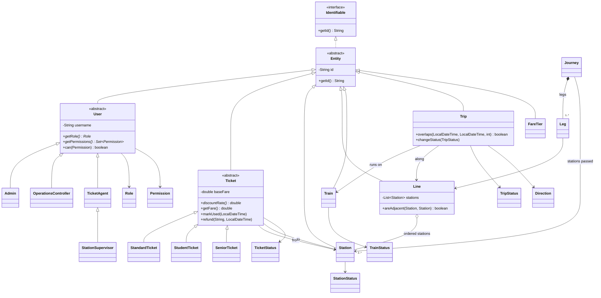
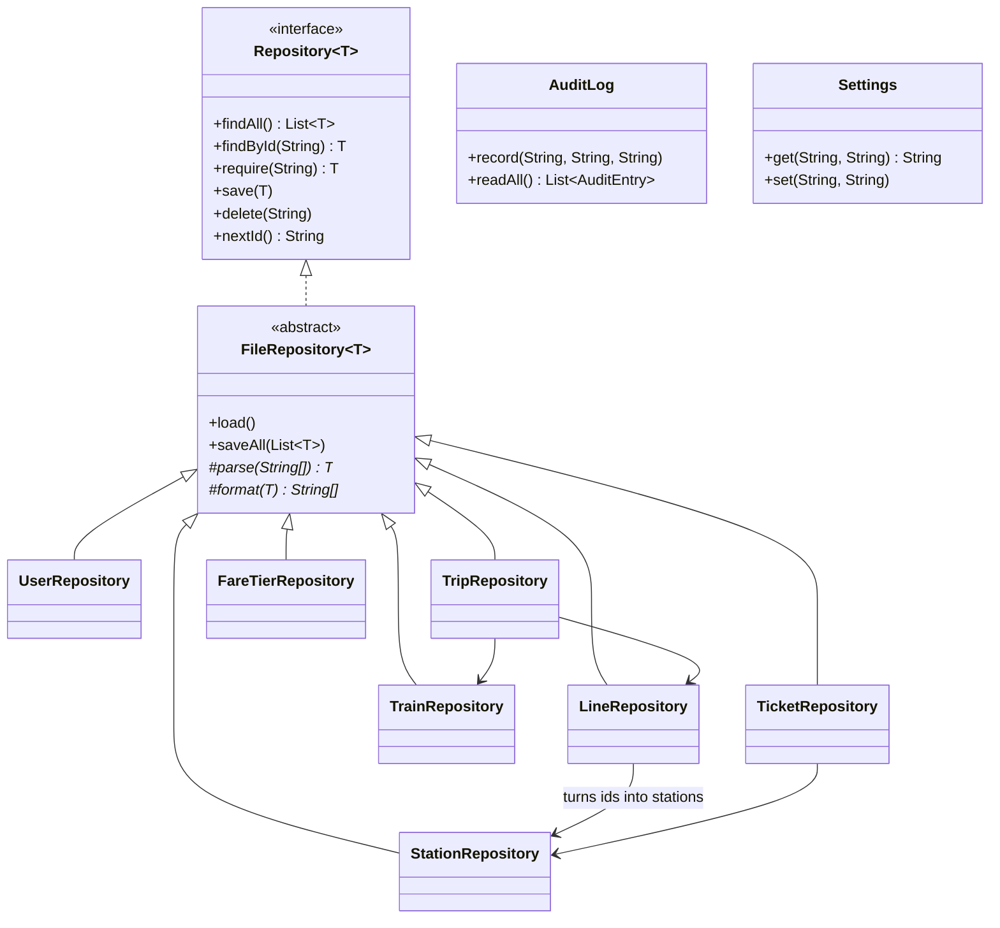
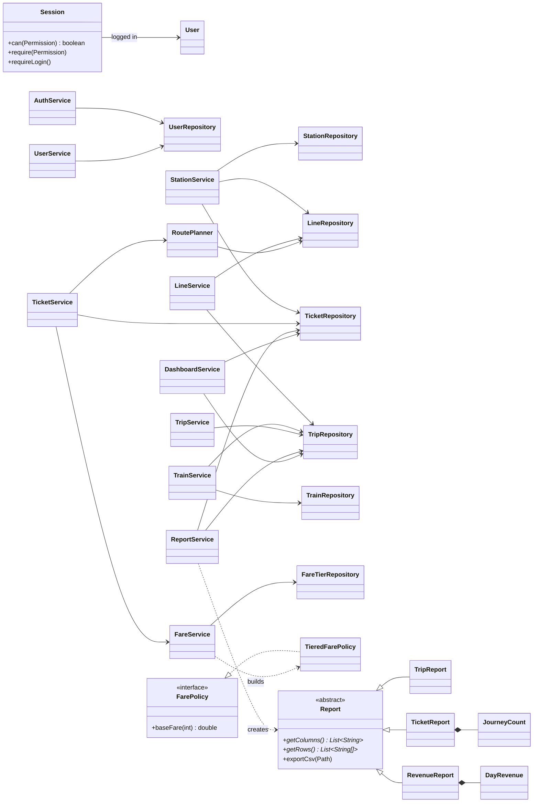
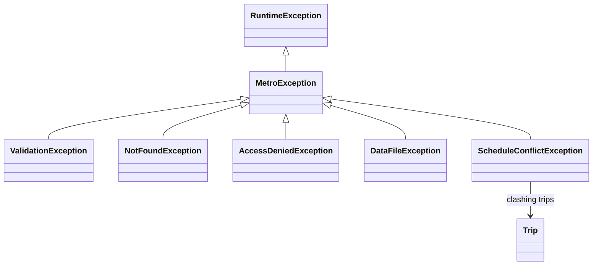
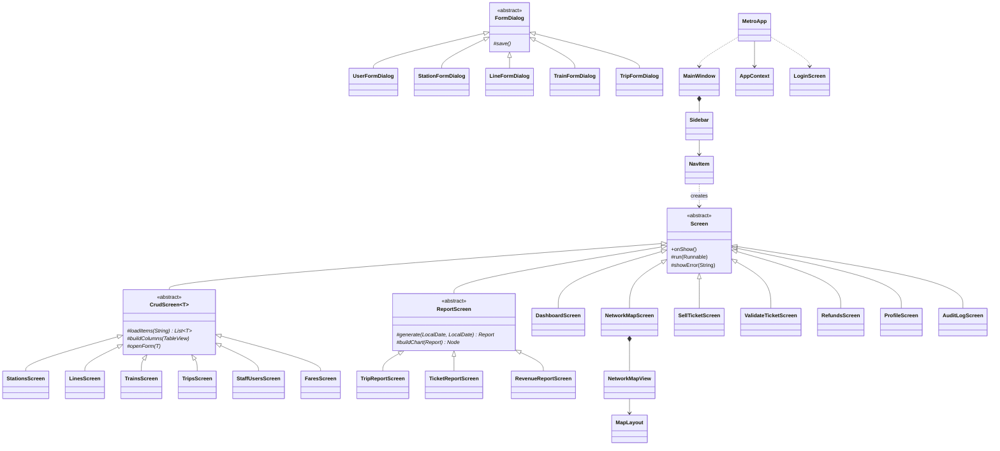

# Class diagrams

Drawn from the finished code. Every arrow below exists in `src/main/java`.
Fields and methods are left out except where they explain an arrow; open the
class to see the rest.

Arrow key: `<|--` inherits (extends), `<|..` implements, `*--` composition
(the part belongs to the whole), `o--` aggregation (shared parts), `-->` uses /
refers to.

## 1. Model — the records and how they relate

`UserFactory` and `TicketFactory` create the right subclass for a `Role` or a
`TicketType`. `TicketCheck` and `AuditEntry` are small result objects.

## 2. Storage — repositories and data files

| Class | File |
|---|---|
| `UserRepository` | `users.txt` |
| `StationRepository` | `stations.txt` |
| `LineRepository` | `lines.txt` |
| `TrainRepository` | `trains.txt` |
| `TripRepository` | `trips.txt` |
| `FareTierRepository` | `fares.txt` |
| `TicketRepository` | `tickets.txt` |
| `AuditLog` | `audit.log` (append-only) |
| `Settings` | `settings.txt` |

## 3. Services — the rules

Every service also holds the one `Session` and the `AuditLog`; those arrows are
left out to keep the picture readable. `AppContext` creates all repositories and
services once, at start-up.

## 4. Errors

## 5. Screens

Small forms that belong to one screen are nested inside it and also extend
`FormDialog`: `StaffUsersScreen.RoleDialog`, `StaffUsersScreen.PasswordDialog`,
`TripsScreen.DelayDialog` and `FaresScreen.TierDialog`.
