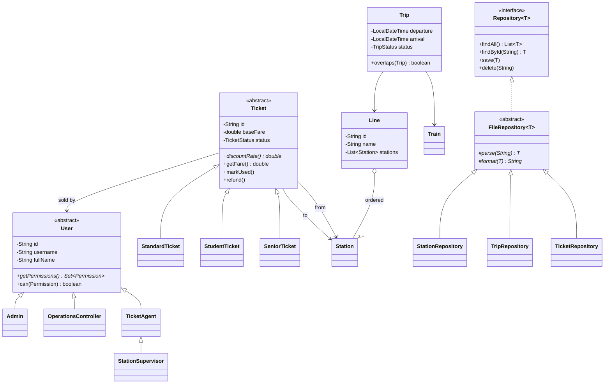

# Metro Management System — Design

**Status:** approved by the team lead on 2026-11-15
**Date:** 2026-11-15
**Course:** Programming Language 2 (Java) — Project 8

This document says what we are building, why, and how the pieces fit.
The step-by-step build plan (`docs/plan.md`) is written from it once it
is approved.

---

## 1. Intent

Build the Metro Management System from the course project list as a
desktop application that a team of six can present on discussion day:
it must satisfy every line of the Project 8 specification, score full
marks on the rubric, and look and feel like a real product rather than a
homework exercise.

The rubric decides what "good" means, so it drives the design:

| Rubric item | Marks | What the design does about it |
|---|---|---|
| OOP design and implementation | 5 | Class hierarchies chosen so every concept (encapsulation, inheritance, polymorphism, abstraction, relationships) has an obvious, explainable example — see §7 |
| Fulfilment of all modules | 4 | Navigation mirrors the five spec modules by name; a traceability table maps each spec line to a screen — see §4 |
| Functionality and correctness | 2 | Business rules live in one layer and are covered by automated tests |
| User authorization | 2 | Permissions checked twice: the menu hides what you cannot use, and the logic refuses it anyway — see §5 |
| File handling | 2 | All data in readable text files that visibly change as the app is used — see §8 |
| Individual work | 5 | One owner per module, code kept at course level, and an "explain it" guide per module — see §10 |
| GUI (missing = −5) | — | JavaFX desktop GUI |

## 2. Goals, non-goals, anti-goals

**Goals**

- Every requirement 1a–5c of Project 8 works, and an examiner can find
  each one in seconds.
- Looks modern and professional: clean theme, light and dark mode,
  dashboard, a live metro map, charts in reports.
- Runs offline from one laptop with no setup on discussion day.
- Each of the six members can open their module and explain every class.
- The repository itself looks professional: README with screenshots,
  class diagram, tests, a green build badge.

**Non-goals** (deliberately left out)

- A database. The rubric grades file handling.
- Real payments, card readers, gate hardware, live train tracking.
- Passenger self-service accounts. The spec says *staff* users.
- Several people using the system at the same time over a network.
- A web version. It may come later (§12); nothing in this build depends on it.

**Anti-goals** (things that would make the project fail even if it works)

- Code the team cannot explain: heavy frameworks, "magic" wiring,
  language features far beyond the course.
- A feature that can crash or look broken during the live demo.
- Data files that can be corrupted or silently lose a record.
- Flashy extras finished before the rubric items are.

## 3. Constraints

- Language: Java. GUI: JavaFX (the toolkit the course textbook teaches).
- Persistence: files only.
- Team of six; skill levels vary; GUI programming is self-taught from the textbook.
- Must build and run with only a JDK installed (the build tool is bundled
  in the repo as a wrapper script).
- The repository is public. No teammate names, student IDs or college
  handouts are committed.
- Discussion date: not known yet. The roadmap (§11) is ordered so the
  graded items are complete first and polish comes after.

## 4. What the system does

Each row is one line of the official specification.

### Module 1 — Administration

| Spec | Requirement | In the app |
|---|---|---|
| 1a | Add, update, delete, list, search stations | **Stations** screen: searchable table, add/edit form, delete with safety check |
| 1b | Create and manage lines and their station sequences | **Lines** screen: line name and colour, ordered station list with add / remove / move up / move down |
| 1c | Record and update train IDs, capacities, service status | **Trains** screen: table and form; status is Active, In maintenance or Retired |

Rules:
- Station names are unique. A station on two or more lines is an interchange (worked out automatically).
- Nothing is deleted while something else still points to it (a station that is on a line, a train with upcoming trips). The app explains why and offers the safe alternative: mark the station Closed or the train Retired.
- A line needs at least two stations.
- A line is one ordered sequence of stations. A line that splits into
  branches is entered as two lines that share the common stations.

### Module 2 — Schedule

| Spec | Requirement | In the app |
|---|---|---|
| 2a | Create train schedules with departure and arrival times | **Trips** screen → New trip: pick line, direction, train, date, departure. Arrival is suggested from the number of stops and can be edited |
| 2b | Update or cancel scheduled trips | Edit and Cancel actions on a trip |
| 2c | Track status: scheduled, delayed, cancelled, completed | Status shown as a coloured badge; allowed changes only (see below) |
| 2d | Detect conflicting schedules for the same train | Saving is refused if the train already has a trip that overlaps in time; the message names the clashing trip |

Rules:
- Two trips of the same train conflict when their time ranges overlap
  (cancelled trips are ignored). A small turnaround gap between trips is required.
- Marking a trip Delayed takes the delay in minutes, moves its arrival,
  and re-checks the train's next trip for a knock-on conflict.
- Status changes: Scheduled → Delayed, Completed or Cancelled;
  Delayed → Completed or Cancelled. Completed and Cancelled are final.
- Only an Active train can be scheduled. Arrival must be after departure.

### Module 3 — Tickets

| Spec | Requirement | In the app |
|---|---|---|
| 3a | Record ticket sales for selected stations and journeys | **Sell ticket** screen: pick origin and destination (from lists or by clicking the map), ticket type, quantity |
| 3b | Calculate fare from the journey / number of stations | Route planner finds the shortest route across lines; fare comes from the number of stations and the ticket type |
| 3c | Check ticket details and mark as used | **Validate** screen: enter the ticket code, see its details and a clear Accept / Reject verdict; an accepted ticket becomes Used |
| 3d | Record eligible cancellations and refunds | **Refunds** screen: find a ticket, see whether it is eligible and why, record the refund |

Rules:
- Fare tiers are data, not code: "up to N stations costs X". Seeded with
  Cairo-style tiers (for example up to 9, 16, 23 stations, and more);
  an admin can edit them. Seed values are examples and should be checked
  against the current official fares before the demo.
- Ticket types (Standard, Student, Senior) each apply their own discount.
- A ticket is valid on its day of sale. Validation rejects a ticket that
  is unknown, already used, refunded or expired, and says which.
- A refund is allowed only for a ticket that was never used and was sold
  today, and returns the full fare paid. Refunded tickets keep their
  record; revenue reports subtract them.
- Selling a quantity of tickets creates one record per ticket, each with its own code.
- No ticket can be sold between stations with no route, or to/from a closed station.

### Module 4 — Reports

| Spec | Requirement | In the app |
|---|---|---|
| 4a | Trip reports by date, line and service status | **Trip report**: filters, result table, status breakdown chart |
| 4b | Number of tickets sold for each journey | **Ticket report**: tickets per origin → destination pair, busiest first, bar chart |
| 4c | Revenue summary for a selected period | **Revenue report**: date range, totals (sales, refunds, net), revenue-per-day chart |

Every report can be exported to a CSV file.

### Module 5 — Users

| Spec | Requirement | In the app |
|---|---|---|
| 5a | Staff log in and log out | Login screen; Log out in the user menu |
| 5b | Update personal information except the ID | **My profile**: editable name, phone, email, password; ID shown read-only |
| 5c | Restrict features by role and permissions | See §5 |

Needed but not spelled out in the spec: somebody has to create staff
accounts, so admins get a **Staff users** screen (add, edit, deactivate,
set role, reset password). Passwords are never stored as plain text.
Staff accounts are deactivated rather than deleted, because tickets and
log entries refer to them; a deactivated account cannot log in, and the
last active admin cannot be deactivated.

## 5. Roles and permissions

Four staff roles. Each role is a Java class that states its own
permissions, so "what can this user do?" is answered by polymorphism.

| Permission | Admin | Operations controller | Ticket agent | Station supervisor |
|---|:-:|:-:|:-:|:-:|
| Manage stations, lines, trains | ✔ | | | |
| Manage staff users and fare tiers, read the audit log | ✔ | | | |
| Create / edit / cancel trips, set trip status | ✔ | ✔ | | |
| View trips and network map | ✔ | ✔ | ✔ | ✔ |
| Sell tickets, validate tickets | ✔ | | ✔ | ✔ |
| Record refunds | ✔ | | | ✔ |
| View reports | ✔ | | | |
| Edit own profile | ✔ | ✔ | ✔ | ✔ |

Enforced in two places:
1. **Interface** — menu items and buttons a user has no permission for are not shown.
2. **Logic** — every operation checks the permission again and refuses
   with an "access denied" error. Even a bug in the interface cannot let
   an agent delete a station.

## 6. Architecture

Four layers. Each layer talks only to the one below it.

```
ui          JavaFX screens. No business rules, no file access.
  ↓
service     Business rules, validation, permission checks.
  ↓
repository  Reads and writes the data files.
  ↓
data/*.txt  Plain text files.

model       The domain classes (Station, Trip, Ticket…), used by all layers.
```

- `model` and `service` do not import JavaFX. They can be tested without
  opening a window, and could sit behind a different interface later.
- No dependency-injection framework. One small `AppContext` object creates
  the repositories and services at start-up and hands them to the screens.
- Screens are written in Java code (as the textbook teaches), styled with
  CSS. No FXML: it would hide the object-oriented structure in XML and
  add a second language to explain.

**Explainability rule.** Code sticks to what the course covers: classes,
inheritance, abstract classes, interfaces, enums, exceptions, `ArrayList`,
text I/O, and lambdas for button handlers. Generics appear in exactly two
base classes. No reflection, no annotation-driven frameworks; a plain
loop is preferred over a clever one-liner.

## 7. Object-oriented design



Where each graded concept shows up:

| Concept | Example an examiner can be shown |
|---|---|
| Encapsulation | All fields private; setters validate. `User` has no `setId`, which is exactly spec line 5b ("except the ID") |
| Inheritance | `User` → four roles, with `StationSupervisor` extending `TicketAgent`; `Ticket` → three types; `FileRepository` → one per entity; `CrudScreen` → Stations, Trains, Staff screens |
| Polymorphism | `user.getPermissions()` differs per role; `ticket.getFare()` differs per type; one save routine works for any repository through `parse` / `format` |
| Abstraction | Abstract classes `User`, `Ticket`, `FileRepository`, `Report`; interfaces `Repository`, `Identifiable`, `FarePolicy` |
| Relationships | A `Line` aggregates an ordered list of `Station`s; a `Trip` associates a `Train` and a `Line`; a `Journey` is composed of route legs |
| Exceptions | Own hierarchy: `MetroException` → `ValidationException`, `ScheduleConflictException`, `AccessDeniedException`, `DataFileException` |

Two pieces of logic carry the "this is more than CRUD" weight:

- **Route planner** — treats the network as a graph and finds the route
  with the fewest stations between any two stations, changing lines at
  interchanges. Feeds the fare and the map highlight.
- **Conflict detector** — interval-overlap check per train, reused when a
  trip is created, edited or delayed.

## 8. Data files

A `data/` folder next to the application. One UTF-8 text file per kind of
record, one record per line, fields separated by `|`.

| File | One line holds |
|---|---|
| `users.txt` | id, username, password hash, salt, role, full name, phone, email, active |
| `stations.txt` | id, name, Arabic name, status |
| `lines.txt` | id, name, colour, ordered list of station ids |
| `trains.txt` | id, capacity, status |
| `trips.txt` | id, train id, line id, direction, departure, arrival, status, delay minutes |
| `tickets.txt` | id, type, from, to, station count, base fare, sold by, sold at, status, used at, refund details |
| `fares.txt` | fare tiers: max stations, price |
| `audit.log` | append-only: time, user, action, detail |

- **Retrieve:** files are loaded at start-up. **Save / modify:** every
  change rewrites the affected file. The new content is written to a
  temporary file first and then swapped in, so a crash mid-save cannot
  leave a half-written file.
- A damaged line is reported with its file name and line number rather
  than silently skipped.
- Records refer to each other by id. Ids are generated (`STN-014`,
  `TRP-0231`, `TKT-000457`) and never reused.
- First run creates `data/` from built-in demo data: the Cairo Metro
  network (three lines, real station names), a small train fleet, a week
  of trips, sample ticket sales, and one account per role. A
  "Reset demo data" action restores it before a presentation.
- `data/` is not committed to git.

Text files were chosen over Java object serialization or a JSON library
because the course teaches text I/O, the team can explain every line of
the reading and writing code, and an examiner can open a file and watch
it change after a sale.

## 9. Interface

One window: a sidebar grouped by the five spec modules, and a content
area. The sidebar shows only what the logged-in role may use.

```
┌─────────────────────────────────────────────────────────────────────────┐
│ (M) Metro Management                              ☾   S. Nabil · Admin ▾│
├────────────────┬────────────────────────────────────────────────────────┤
│  Dashboard     │  Trips today    Delayed    Tickets sold    Revenue     │
│  Network map   │  [   42   ]     [  3  ]    [  1,284  ]     [ 11,930 ]  │
│                │                                                        │
│ ADMINISTRATION │  ┌─ Network ────────────────┐  ┌─ Next departures ───┐ │
│  Stations      │  │  ●━━●━━◉━━●━━●━━●━━●     │  │ 14:05  L1  On time  │ │
│  Lines         │  │        ┃                 │  │ 14:10  L2  Delayed  │ │
│  Trains        │  │  ●━━●━━◉━━●━━◉━━●        │  │ 14:12  L3  On time  │ │
│ SCHEDULE       │  │              ┃           │  │ …                   │ │
│  Trips         │  │     ●━━●━━●━━◉━━●━━●     │  └─────────────────────┘ │
│ TICKETS        │  └──────────────────────────┘                          │
│  Sell ticket   │                                                        │
│  Validate      │                                                        │
│  Refunds       │                                                        │
│  Fares         │                                                        │
│ REPORTS        │                                                        │
│  Trips         │                                                        │
│  Tickets       │                                                        │
│  Revenue       │                                                        │
│ ACCOUNT        │                                                        │
│  Staff users   │                                                        │
│  My profile    │                                                        │
└────────────────┴────────────────────────────────────────────────────────┘
```

- **Look:** a modern flat theme with light and dark mode, an icon set, one
  accent colour, line colours taken from the data. The theme and icons
  are the only third-party pieces in the interface and are isolated: if
  the course does not allow libraries, they are swapped for our own CSS
  without touching any screen.
- **Dashboard:** everyone lands here after login; each tile and panel
  appears only if the role may see that information (revenue is
  admin-only, for example).
- **Network map:** drawn from whatever lines and stations exist, so it
  stays correct when an admin edits the network. Click two stations to
  see the route, the number of stations, the changes and the fare.
- **Lists:** every table has a search box and sensible filters.
- **Feedback:** inline validation messages in plain language, confirmation
  before anything destructive, a short notice after each successful action.
- **Sell ticket** ends with a ticket card (code, journey, type, fare,
  time) the way a printed ticket would look.
- Interface language is English. Stations also carry an Arabic name.

## 10. Team split

One owner per spec module, so each member can demonstrate and explain a
complete slice: its classes, its file, its rules and its screens.

| Owner | Area | Covers |
|---|---|---|
| 1 (team lead) | Foundation and integration | Project setup, main window and navigation, shared base classes, route planner and network map, demo data, release |
| 2 | Users | Login/logout, roles and permissions, profile, staff users |
| 3 | Administration | Stations, lines and station sequences, trains |
| 4 | Schedule | Trips, status changes, conflict detection |
| 5 | Tickets | Sales, fares, validation, refunds |
| 6 | Reports | Trip, ticket and revenue reports, charts, export |

The team lead maps owners to people; that mapping stays out of the
public repository.

Each module ships with `docs/modules/<module>.md`: what each class is
for, which OOP concepts it shows, how its data file looks, and the
questions an examiner is likely to ask with model answers. This is the
preparation for the five individual marks.

Working agreement: `main` always builds and runs. Work happens on one
branch per module and is merged through a pull request.

## 11. Roadmap

Ordered so the application can be demonstrated at the end of every
phase, and so everything the rubric grades is done by the end of phase 5.

| Phase | Result |
|---|---|
| 0. Skeleton | Project builds with one command; an empty themed window opens; automated build runs on GitHub |
| 1. Foundation | Base classes, file storage, demo data, login, main window, role-based menu, profile |
| 2. Administration | Stations, lines, trains complete |
| 3. Schedule | Trips with status tracking and conflict detection |
| 4. Tickets | Route planner, fares, sales, validation, refunds |
| 5. Reports | Three reports with filters and export — **all rubric items covered** |
| 6. Polish | Dashboard, network map, charts, dark mode, audit log, empty and error states |
| 7. Discussion prep | Module explain-guides, class diagram, README with screenshots, demo script, rehearsal, filled cover sheet |
| Later | Installer that needs no Java on the target machine; showcase website |

Stretch ideas, only after phase 7 is solid: Arabic interface toggle,
per-train timeline view of the schedule, QR code on the ticket card,
per-user permission overrides.

## 12. Deployment (later)

Not part of this build. The intended path:

- Package the app with its own Java runtime so it installs and runs on a
  machine with nothing pre-installed; publish it as a GitHub release.
- A static showcase site (screenshots, feature tour, download button,
  class diagram) on Cloudflare Pages. Pages serves static files only, so
  it hosts the site and the download link, not the Java program.

## 13. Quality

- Automated tests for the logic that can be wrong in subtle ways: fare
  tiers, route planner, schedule conflicts, status transitions, refund
  eligibility, permissions, and file round-trips (save then load gives
  the same objects).
- Screens are checked by hand against a written demo script that walks
  through every spec line.
- Every build on GitHub compiles the project and runs the tests.

## 14. Approaches considered

| Approach | Trade-off | Decision |
|---|---|---|
| **JavaFX desktop app**, all Java, text-file storage | Everything graded is Java the team can explain; runs offline; matches the textbook. No live web link | **Chosen by the team lead** |
| Web app: Java server plus a browser interface | Feels like a website, but the interface is JavaScript, which the course does not grade and teammates would still have to explain; the server cannot be hosted on Cloudflare Pages | Rejected |
| JavaFX now, small public web page later | Safest grade plus a live link, at the cost of extra work | Kept open as a later step (§12) |

## 15. Decisions made in this design, open to change

These were not specified by the team lead; they are the designer's
choices and can be overruled.

- Four roles (Admin, Operations controller, Ticket agent, Station supervisor) and the permission table in §5.
- Staff-user management screen for admins, although the spec does not list it.
- Text files with `|` separators rather than serialization or JSON.
- Screens written in Java code rather than FXML.
- Third-party theme and icon libraries, isolated so they can be removed.
- Cairo Metro as demo data; English interface.
- Ticket rules: valid on day of sale; refund only if unused and sold today.
- One owner per module as in §10.
- Documents live in `docs/` (`design.md`, `plan.md`, `modules/`).

**For the team lead to confirm with the course staff:** whether
third-party libraries (theme, icons, test framework) are acceptable, and
the discussion date.

## 16. Left to the builder

Exact Java and JavaFX versions (target: a current long-term-support
release that runs on the JDK already installed, verified in phase 0),
package names, the precise file-line formats and escaping, id formats,
turnaround gap and discount values, the map layout algorithm, colour
palette and spacing, and which theme and icon libraries to use.
